<a href="https://www.tobhoster.com">
  <picture>
    <source media="(prefers-color-scheme: dark)" srcset="./assets/banner-dark.svg">
    <source media="(prefers-color-scheme: light)" srcset="./assets/banner-light.svg">
    
  </picture>
</a>

## I build backend systems and the infrastructure they run on.

**Tobi** (Oluwatobi Adebiyi) · SDE II at Amazon (Amazon Ads, previously AWS) · New York · building software since 2016

Always happy to talk Rust, infrastructure or aviation software.\
[tobhoster.com](https://www.tobhoster.com) · [Book a call](https://calendar.app.google/sKQCCgde82MNAVFN6) · [tobi@tobhoster.com](mailto:tobi@tobhoster.com) · [LinkedIn](https://www.linkedin.com/in/oluwatobi-adebiyi-50a64960/)

### Founder track

**[WingWrangler](https://www.wingwrangler.com)** · my current startup\
Management software for flight schools and flying clubs: scheduling, fleet, maintenance, logbooks, billing and weather. Happy to talk about it [on a call](https://calendar.app.google/sKQCCgde82MNAVFN6).

**Razu** · co-founder & CTO · [logo on the New Jersey Devils' helmets](https://www.roi-nj.com/2021/12/07/lifestyle/meet-razu-the-music-collaboration-company-whose-logo-will-appear-on-devils-helmets/)\
A music-collaboration platform that gives creators tools to make and enhance songs together, virtually. I built the backend in Go and TypeScript and led a team of four engineers across time zones. Razu won the Devils' Buy Black program, presented by Prudential.

**[JoatSpace](https://www.joatspace.com)** · founder · [@JoatSpace](https://github.com/JoatSpace)\
A platform connecting freelancers and small businesses with clients in Nigeria, Ghana, Uganda, Tanzania and Kenya. I built the backend and the iOS and Android apps, and mentored a team of five interns.

### Featured work

**Global Trade Compliance at AWS** · TypeScript · Step Functions · DynamoDB\
At AWS I worked on the platform that moves parts and purchase orders from suppliers to data centers and between facilities. It automates customs documentation, Incoterms classification and export-license screening across 40+ countries, at a 99.9% compliance rate. [More on tobhoster.com](https://www.tobhoster.com/projects)

**[flinch](https://github.com/tobhoster/flinch)** · open source · Rust · MIT\
Keeps your Plex library under 80% full, and never deletes what your household still wants. For every movie and season it forecasts the chance nobody plays it in the next 30 days, then frees the least-missed gigabytes first.\
*Design calls:* missing evidence means keep. It learns from Plex, Tautulli, Radarr and Sonarr history, but only trusts a learned model once it beats the built-in one on a daily replay of its own past. flinch only decides; Maintainerr does the deleting.\
**[Try the demo →](https://github.com/tobhoster/flinch#-try-the-demo)**

**Homelab** · Kubernetes · GitOps\
A small Kubernetes cluster at home, managed from Git. It runs 20+ self-hosted apps, and it's where flinch started.

**Also on the bench:** [tobhoster.com](https://www.tobhoster.com), my editor-themed portfolio in Astro and TypeScript with a <kbd>⌘</kbd> <kbd>K</kbd> command palette, and a [USCIS civics test trainer](https://www.tobhoster.com/civics) that turns all 128 questions of the 2025 test into spaced-repetition flashcards.

### Stack

Rust · Go · TypeScript · Python · AWS (Lambda, DynamoDB, Step Functions, ECS) · Kubernetes · Flux · Terraform · Docker · Envoy · PostgreSQL · Redis · NATS JetStream · gRPC

<b>Career</b>

 

- **Amazon**, Feb 2022 to present. Software Development Engineer II on Amazon Ads. Before Ads I was at AWS, working on the Global Trade Compliance platform.
- **Lunchbox**, 2020 to 2022. Backend Engineer, then Senior Software Engineer. Worked on the rewrite from a monolith to microservices and on point-of-sale integrations with Square, Stripe, Braintree and Toast.
- **Moolre**, 2017 to 2018. Software Engineer. Two-factor authentication, chat and notifications, on MongoDB.
- **Snap Inc.**, summer 2016. Software QA Engineer Intern. UI test automation for Stories and Discover, plus test cases that cut Android bugs by 20%.
- **Founder roles:** WingWrangler, my current startup; founder of JoatSpace (2018 to 2020); co-founder & CTO of Razu. More under Founder track above.
- **New York Institute of Technology:** B.S. Computer Science (2017), M.S. Computer Science & IT (2020).

Some of these overlapped: the founder roles ran alongside other jobs and my M.S.

